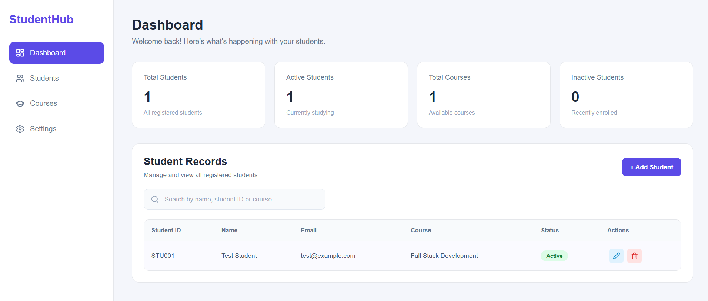

# StudentHub – Student Management System

A full-stack Student Management System built using React.js, Node.js, Express.js and MySQL. StudentHub allows administrators to manage student records through an interactive dashboard with real-time database integration.

## Dashboard Preview



## Features

- **Dashboard:** View student statistics dynamically.
- **Add Students:** Register new students with unique Student IDs.
- **View Students:** Fetch student records directly from MySQL.
- **Edit Students:** Update existing student information.
- **Delete Students:** Remove student records with confirmation.
- **Search:** Search students by name, Student ID or course.
- **Student Status:** Manage Active and Inactive students.
- **Persistent Storage:** Student information remains saved after refreshing the application.

## Technologies Used

**Frontend**
- React.js
- JavaScript
- HTML5
- CSS3
- Lucide React

**Backend**
- Node.js
- Express.js
- REST APIs
- MySQL2
- CORS
- Dotenv

**Database**
- MySQL

**Development Tools**
- Visual Studio Code
- Git
- GitHub
- Postman / PowerShell for API testing

## Project Structure

```text
StudentHub/
│
├── backend/
│   ├── db.js
│   ├── server.js
│   ├── package.json
│   └── .env
│
├── frontend/
│   ├── public/
│   ├── src/
│   │   ├── assets/
│   │   ├── App.jsx
│   │   ├── App.css
│   │   ├── index.css
│   │   └── main.jsx
│   └── package.json
│
├── .gitignore
└── README.md
```

## Installation and Setup

### 1. Clone the repository

```bash
git clone https://github.com/fahil-shaikh/StudentHub.git
cd StudentHub
```

### 2. Set up the MySQL database

Open MySQL and execute:

```sql
CREATE DATABASE studenthub;

USE studenthub;

CREATE TABLE students (
    id INT AUTO_INCREMENT PRIMARY KEY,
    student_id VARCHAR(20) UNIQUE NOT NULL,
    name VARCHAR(100) NOT NULL,
    email VARCHAR(100),
    course VARCHAR(100),
    status ENUM('Active', 'Inactive') DEFAULT 'Active',
    created_at TIMESTAMP DEFAULT CURRENT_TIMESTAMP
);
```

### 3. Set up the backend

Open a terminal:

```bash
cd backend
npm install
```

Create a `.env` file inside the backend folder:

```env
DB_HOST=localhost
DB_USER=root
DB_PASSWORD=YOUR_MYSQL_PASSWORD
DB_NAME=studenthub
DB_PORT=3306
PORT=5000
```

Replace `YOUR_MYSQL_PASSWORD` with your own MySQL password.

Start the backend:

```bash
node server.js
```

Backend runs at:

`http://localhost:5000`

### 4. Set up the frontend

Open another terminal:

```bash
cd frontend
npm install
npm run dev
```

Open the frontend in your browser:

`http://localhost:5173`

## API Endpoints

| Method | Endpoint | Description |
|---|---|---|
| GET | `/api/students` | Retrieve all students |
| POST | `/api/students` | Add a new student |
| PUT | `/api/students/:studentId` | Update a student |
| DELETE | `/api/students/:studentId` | Delete a student |

## Database Security

- Database credentials are stored in environment variables.
- `.env` files are excluded using `.gitignore`.
- Database passwords should never be committed to GitHub.

## Future Enhancements

- Student attendance management
- Fee and payment tracking
- Advanced reporting and analytics
- Authentication and role-based access
- Student profile management

## Author

**Mohammad Fahil Shaikh**

GitHub: https://github.com/fahil-shaikh

---

*StudentHub – Making student management simpler and smarter.*